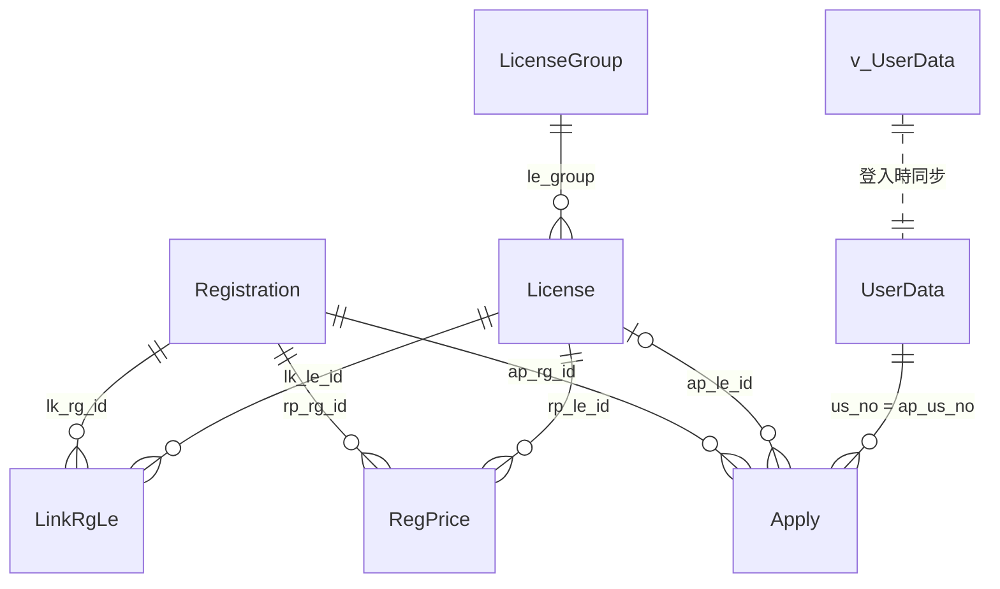

# 資料庫描述文件

證照報名系統（LRS）使用 SQL Server。資料表沿用舊 PHP 系統的結構，新系統只**新增**欄位與資料表，不修改、不刪除既有欄位，新舊系統在切換前可以共用同一份資料。

- 結構以測試資料庫 `CertregApp_Test` 實際查詢結果為準（2026-11-03）。
- 「新增」標記的欄位與資料表是新系統加的，正式資料庫需手動執行 [`pending-production-changes.sql`](pending-production-changes.sql)，程式不會自動建立。
- 資料表之間沒有建立外鍵（與舊系統相同），關聯由程式維護。
- 日期時間欄位（`datetime`）一律是台灣時間，沒有時區資訊。

## 關聯圖

| 資料表 | 用途 |
|---|---|
| [`LicenseGroup`](#licensegroup-證照分類) | 證照分類 |
| [`License`](#license-證照項目) | 證照項目 |
| [`Registration`](#registration-考試場次) | 考試場次 |
| [`LinkRgLe`](#linkrgle-考試開放的項目) | 考試開放哪些項目（多對多） |
| [`RegPrice`](#regprice-考試項目價格新增) | 考試項目的原價與優惠方案（新增） |
| [`Apply`](#apply-報名紀錄) | 報名紀錄 |
| [`UserData`](#userdata-使用者資料) | 使用者資料 |
| [`v_UserData`](#v_userdata-校務系統師生資料檢視) | 校務系統師生資料（檢視） |

## LicenseGroup 證照分類

| 欄位 | 型別 | NULL | 預設 | 說明 |
|---|---|---|---|---|
| `lg_id` | int IDENTITY | 否 | | 主鍵 |
| `lg_name` | nvarchar(255) | 否 | | 分類名稱，不可重複 |
| `lg_order` | tinyint | 否 | 0 | 顯示順序；名稱為「其他」的分類固定排最後 |
| `lg_is_hidden` | bit | 否 | 0 | **新增**。1 = 已隱藏。分類不可刪除，只能隱藏；隱藏後不出現在新增考試、新增或移動證照項目的選單 |

## License 證照項目

| 欄位 | 型別 | NULL | 預設 | 說明 |
|---|---|---|---|---|
| `le_id` | int IDENTITY | 否 | | 主鍵 |
| `le_name` | nvarchar(50) | 否 | | 項目名稱；部分舊資料帶前後空白，程式讀取時會去除 |
| `le_creatDate` | datetime | 否 | getdate() | 建立時間 |
| `le_order` | int | 否 | 0 | 顯示順序 |
| `le_group` | int | 是 | | 所屬分類 → `LicenseGroup.lg_id` |
| `le_is_del` | bit | 否 | 0 | 1 = 已隱藏（沿用舊欄位）。項目不可刪除，只能隱藏；隱藏後不能用於新增考試，舊系統同樣不顯示 |

## Registration 考試場次

| 欄位 | 型別 | NULL | 預設 | 說明 |
|---|---|---|---|---|
| `rg_id` | int IDENTITY | 否 | | 主鍵 |
| `rg_name` | nvarchar(255) | 否 | | 考試名稱；建立後不可修改 |
| `rg_startDate` | datetime | 否 | | 考試起始時間 |
| `rg_endDate` | datetime | 否 | | 考試結束時間；結束後不可再修改考試 |
| `rg_memo` | nvarchar(3000) | 否 | | 備註（考試說明） |
| `rg_applyEndDate` | datetime | 否 | | 報名截止時間，也是繳款期限；截止後不可報名、修改或取消 |
| `rg_money` | int | 否 | 0 | 考試費用。項目沒有另外設定價格時即為原價 |
| `rg_creator` | nvarchar(20) | 否 | | 建立者帳號 |
| `rg_creatDate` | datetime | 否 | getdate() | 建立時間 |
| `rg_number` | int | 否 | 40 | 報名人數上限（有效報名，不含已取消） |
| `rg_is_regi` | bit | 是 | | 1 = 需要到認證官網註冊，報名表會詢問是否已註冊 |
| `rg_is_del` | bit | 否 | 0 | 1 = 下架（學生端看不到、不可報名）；考試不實際刪除 |

## LinkRgLe 考試開放的項目

考試與證照項目的多對多關聯：一場考試可開放多個項目，同一個項目會出現在很多場考試。學生報名時只能選這場考試開放的項目。

| 欄位 | 型別 | NULL | 預設 | 說明 |
|---|---|---|---|---|
| `lk_id` | int IDENTITY | 否 | | 主鍵（程式未使用） |
| `lk_rg_id` | int | 否 | | 考試 → `Registration.rg_id` |
| `lk_le_id` | int | 否 | | 證照項目 → `License.le_id` |

## RegPrice 考試項目價格（新增）

每列為「一場考試 × 一個項目 × 一個收費方案」。

- 某考試某項目**沒有資料**時，原價就是考試費用 `rg_money`，沒有優惠方案。從正式資料庫複製過來的舊考試都是這種情況。
- 原價與考試費用相同時不存資料列。
- 管理端儲存價格時，會整批取代該場考試的所有資料列；已報名者的金額存在 `Apply`，不受影響。

| 欄位 | 型別 | NULL | 預設 | 說明 |
|---|---|---|---|---|
| `rp_id` | int IDENTITY | 否 | | 主鍵 |
| `rp_rg_id` | int | 否 | | 考試 → `Registration.rg_id` |
| `rp_le_id` | int | 否 | | 證照項目 → `License.le_id` |
| `rp_name` | nvarchar(50) | 否 | | 方案名稱。原價固定為「原價」；優惠方案例如「本校生優惠」，同一考試項目內不可重複 |
| `rp_money` | int | 否 | | 費用（元） |
| `rp_is_base` | bit | 否 | 0 | 1 = 原價（每個考試項目最多一筆）；0 = 優惠方案 |
| `rp_order` | int | 否 | 0 | 顯示順序（原價為 0，優惠方案依序 1、2…） |

索引：`IX_RegPrice_rg_le (rp_rg_id, rp_le_id)`

## Apply 報名紀錄

報名當下的考試名稱、項目名稱、費用與個人資料都以快照方式存入，之後考試或使用者資料變更，不影響既有報名紀錄。

| 欄位 | 型別 | NULL | 預設 | 說明 |
|---|---|---|---|---|
| `ap_id` | int IDENTITY | 否 | | 主鍵（報名編號） |
| `ap_rg_id` | int | 否 | | 考試 → `Registration.rg_id` |
| `ap_rg_name` | nvarchar(255) | 否 | | 考試名稱（快照） |
| `ap_le_name` | nvarchar(50) | 否 | | 項目名稱（快照，已去除前後空白） |
| `ap_rg_money` | int | 否 | | 應繳金額（快照）。依所選項目與收費方案計算；繳費單與 TWQR 線上轉帳都用這個金額 |
| `ap_us_no` | varchar(20) | 否 | | 學號（帳號），取自登入身分 |
| `ap_us_name` | nvarchar(50) | 否 | | 中文姓名 |
| `ap_us_ename` | varchar(50) | 否 | | 英文姓名（大寫） |
| `ap_us_id` | varchar(20) | 否 | | 身分證字號 |
| `ap_us_sex` | nvarchar(2) | 否 | | 性別：`M` 男、`F` 女 |
| `ap_us_cdept` | nvarchar(50) | 否 | | 系年班 |
| `ap_us_phone` | varchar(30) | 否 | | 行動電話 |
| `ap_us_email` | nvarchar(80) | 否 | | 電子郵件 |
| `ap_us_memo` | nvarchar(255) | 否 | | 學生填寫的備註（最多 120 字） |
| `ap_is_regi` | bit | 是 | 0 | 是否已在認證官網註冊（考試需要註冊時才填寫） |
| `ap_is_del` | bit | 否 | 0 | 1 = 已取消報名（不實際刪除） |
| `ap_score` | nvarchar(10) | 是 | -1 | 成績；`-1`、空白或「未輸入」表示尚未登錄 |
| `ap_is_pay` | nchar(1) | 是 | 0 | 繳費狀態：`0` 尚未繳費、`1` 已繳費、`2` 退費、`3` 免繳費 |
| `ap_scorePass` | bit | 是 | 0 | 1 = 合格 |
| `ap_createDate` | datetime | 是 | getdate() | 報名時間 |
| `ap_modifyDate` | datetime | 是 | getdate() | 最後修改時間 |
| `ap_le_id` | int | 是 | | **新增**。所選項目 → `License.le_id`。舊紀錄由 SQL 依名稱回填，對應不到的維持 NULL |
| `ap_discount` | nvarchar(50) | 是 | | **新增**。所選優惠方案名稱（快照）；NULL 表示原價。承辦人員收費前核對資格 |

一位學生在同一場考試只能有一筆有效報名（`ap_is_del = 0`），由程式在交易中檢查。

已知的舊資料問題：舊系統「取消報名」沒有檢查登入，`ap_id` 不存在時會改為新增，因此留下 115 筆所有欄位空白、`ap_rg_id = 0` 的紀錄（大多在 2025-01-22）。這些紀錄不會出現在任何清單或匯出中。

## UserData 使用者資料

每次登入時，程式依 `v_UserData` 新增或差異更新這張表；`v_UserData` 讀不到時沿用既有資料，不阻擋登入。

| 欄位 | 型別 | NULL | 預設 | 說明 |
|---|---|---|---|---|
| `us_uid` | int IDENTITY | 否 | | 主鍵 |
| `us_no` | varchar(20) | 否 | | 學號（帳號），不會變動 |
| `us_name` | nvarchar(50) | 否 | | 中文姓名 |
| `us_logid` | varchar(10) | 否 | | 登入代碼（校務系統提供） |
| `us_title` | nvarchar(10) | 否 | | 身分別（校務系統提供） |
| `us_ename` | nvarchar(50) | 是 | | 英文姓名（大寫） |
| `us_id` | varchar(20) | 是 | | 身分證字號，不會變動 |
| `us_sex` | nvarchar(2) | 是 | | 性別：`M` 男、`F` 女 |
| `us_yy` / `us_mm` / `us_dd` | varchar(4) / varchar(2) / varchar(2) | 是 | | 出生年、月、日（名單匯出用） |
| `us_dept` | nvarchar(50) | 是 | | 系所 |
| `us_grade` | tinyint | 是 | | 年級 |
| `us_class` | nchar(1) | 是 | | 班別 |
| `us_phone` | varchar(30) | 是 | | 行動電話。不在 `v_UserData` 中；報名時填寫的值會回存，下次報名預設帶出 |
| `us_email` | nvarchar(80) | 是 | | 電子郵件。同上 |
| `us_createDate` | datetime | 否 | getdate() | 建立時間 |

## v_UserData 校務系統師生資料（檢視）

透過 Linked Server 讀取校務系統的師生資料，程式只讀取，不寫入。欄位與 `UserData` 同名，但長度較寬；超過 `UserData` 欄位長度的值會截斷並記錄警告。

| 欄位 | 型別 | 說明 |
|---|---|---|
| `us_no` | varchar(100) | 學號（帳號） |
| `us_name` | nvarchar(50) | 中文姓名 |
| `us_logid` | varchar(50) | 登入代碼 |
| `us_title` | nvarchar(50) | 身分別 |
| `us_ename` | nvarchar(250) | 英文姓名 |
| `us_id` | varchar(50) | 身分證字號 |
| `us_sex` | char(1) | 性別 |
| `us_yy` / `us_mm` / `us_dd` | varchar(6) / varchar(4) / varchar(4) | 出生年、月、日 |
| `us_dept` | nvarchar(60) | 系所 |
| `us_grade` | varchar(1) | 年級 |
| `us_class` | varchar(1) | 班別 |

## 不在資料庫的資料

正式資料庫不允許程式建表，以下資料存在伺服器本機目錄（`.env` 的 `DATA_DIR`，預設 `backend/data/`，不進版控）：

| 檔案 | 內容 |
|---|---|
| `logs/` | 系統日誌與稽核紀錄（保留 365 天） |
| `permissions.json` | 管理端權限設定（哪些帳號可管理考試、系統） |
